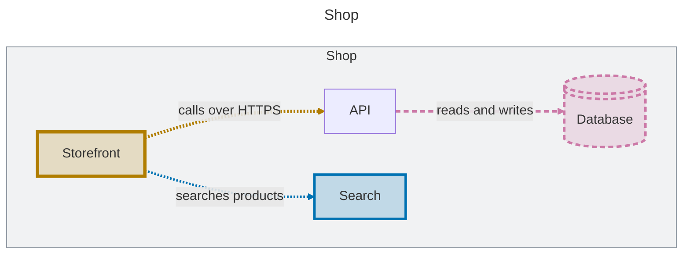

# LikeC4 architecture diff

A GitHub Action that shows the reviewer of a pull request what it changed in the
[LikeC4](https://likec4.dev) architecture model. It compares the model of the pull request with
its base and comments with each view that changed, as one Mermaid diagram that GitHub renders in
place:

- added elements and relationships in blue
- changed ones in amber, with a thicker border
- removed ones in reddish purple, put back where they were, with a dashed border

A change to a description, a technology or a view's include rules counts; a renamed or moved
element shows as removed and added. Views that did not change are left out, and a pull request
that changes no view gets no comment, or its earlier comment says so. The colours come from the
[Okabe-Ito palette](https://jfly.uni-koeln.de/color/), which colour-blind readers tell apart, and
each keeps a 3:1 contrast in GitHub's light and dark themes. The line styles carry the change
too, so the diff reads in greyscale.

For a pull request that retitles the web app *Storefront*, calls the API over HTTPS, adds a search
and drops the database, the comment shows:



## Usage

```yaml
name: architecture-diff

on:
  pull_request:
    paths: ['docs/architecture/**']

permissions:
  contents: read
  pull-requests: write

jobs:
  architecture-diff:
    runs-on: ubuntu-latest
    steps:
      - uses: actions/checkout@v6
      - uses: novibe-org/likec4-architecture-diff-action@v1
```

The `paths` filter runs it only on pull requests that touch the model. It updates its own comment
on each push instead of adding a new one. A pull request from a fork has a read-only token, so
there the diff goes to the job summary only.

## Inputs

| Input | Default | |
|---|---|---|
| `path` | `docs/architecture` | Directory with the LikeC4 model |
| `likec4-version` | `1.60.0` | Version of the [`likec4`](https://www.npmjs.com/package/likec4) package to run |
| `github-token` | `${{ github.token }}` | Token that comments on the pull request |
| `added-color` | `#0072B2` | Hex stroke colour of what the pull request added; the fill is it at 20 % alpha |
| `changed-color` | `#B07D00` | Hex stroke colour of what it changed |
| `removed-color` | `#CC79A7` | Hex stroke colour of what it removed |

## How it works

`likec4 export json` gives the model of both sides, and the diff is taken on that model, not on
pictures. `likec4 gen mermaid` renders the views, and the action adds a style line for each
element and relationship that changed. Nothing is hosted: the Mermaid sits in the comment.

Part of [NoVibe](https://github.com/novibe-org/novibe).

## License

[Apache 2.0](LICENSE)
